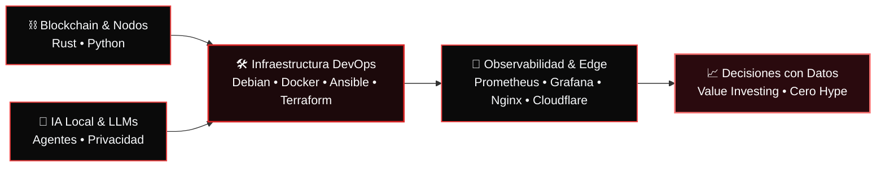

<!-- BANNER SUPERIOR NEGRO & ROJO -->
<div align="center">
  

  <a href="https://github.com/Masterdevp">
    
  </a>

  <br />

  <!-- BADGES DE ESTADO Y CONTACTO -->
<p>
    
    <a href="mailto:contacto@themaster.sh">
      
    </a>
    
  </p>
</div>

---

## 🎯 whoami.yml

```yaml
perfil:
  rol: "Especialista en Blockchain, IA Local & Infraestructura DevOps"
  inversion: "Value Investing (análisis fundamental y margen de seguridad)"
  ubicacion: "España — Remoto / Colaboraciones estratégicas"
  enfoque:
    - "Soberanía tecnológica, privacidad y control total de la infraestructura"
    - "Sistemas resilientes, automatizados y monitorizados al milímetro"
    - "Decisiones respaldadas por métricas reales, nunca por hype"
```

<br>

<table>
  <tr>
    <td width="50%" valign="top">
      <h4>⛓️ Blockchain & Nodos</h4>
      Despliegue y operación de nodos, arquitectura descentralizada y análisis
      técnico profundo de ecosistemas Web3 con criterio de seguridad y
      resiliencia.
    </td>
    <td width="50%" valign="top">
      <h4>🧠 IA Local & LLMs</h4>
      Implementación, optimización y orquestación de modelos de
      <b>IA 100% en local</b> y agentes autónomos sin dependencia de terceros ni
      fugas de datos.
    </td>
  </tr>
  <tr>
    <td width="50%" valign="top">
      <h4>🛠️ DevOps & Observabilidad 24/7</h4>
      Automatización de servidores, infraestructura como código y
      <b>monitoreo en tiempo real</b> con alertas, telemetría y alta
      disponibilidad.
    </td>
    <td width="50%" valign="top">
      <h4>📈 Filosofía Value Investing</h4>
      Búsqueda de valor intrínseco, análisis fundamental riguroso y visión a
      largo plazo aplicada tanto a la asignación de capital como a la
      ingeniería.
    </td>
  </tr>
</table>

---

## 🧩 Arquitectura de Trabajo



---

## 🛠️ Stack Tecnológico

<div align="center">
  <table>
    <tr>
      <th align="center">Infraestructura, DevOps & Monitoreo</th>
      <th align="center">Lenguajes & Desarrollo</th>
    </tr>
    <tr>
      <td align="center">
        
      </td>
      <td align="center">
        
      </td>
    </tr>
    <tr>
      <th align="center">Bases de Datos & Caché</th>
      <th align="center">Herramientas & Documentación</th>
    </tr>
    <tr>
      <td align="center">
        
      </td>
      <td align="center">
        
      </td>
    </tr>
  </table>
</div>

---

## 📊 Estadísticas y Métricas

<div align="center">
  
  
</div>

<br>

<div align="center">
  
</div>

<br>

<div align="center">
  
</div>

---

## 🐍 Contribuciones

<div align="center">
  <picture>
    <source
      media="(prefers-color-scheme: dark)"
      srcset="
        https://raw.githubusercontent.com/Masterdevp/masterdevp/output/github-contribution-grid-snake-dark.svg
      "
    >
    <source
      media="(prefers-color-scheme: light)"
      srcset="
        https://raw.githubusercontent.com/Masterdevp/masterdevp/output/github-contribution-grid-snake.svg
      "
    >
    
  </picture>
</div>

<!-- FOOTER NEGRO & ROJO -->
<div align="center">
  
</div>
